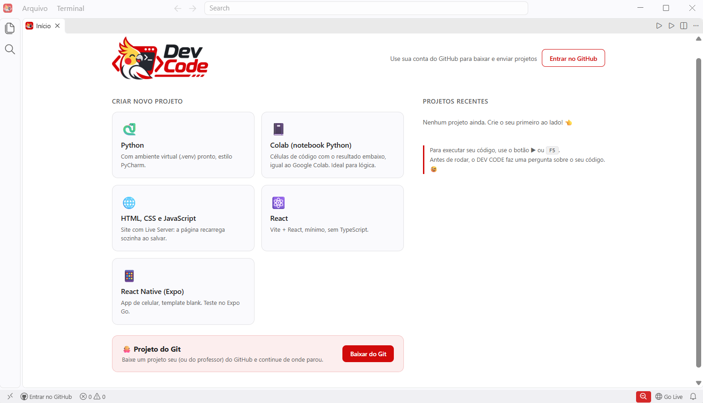
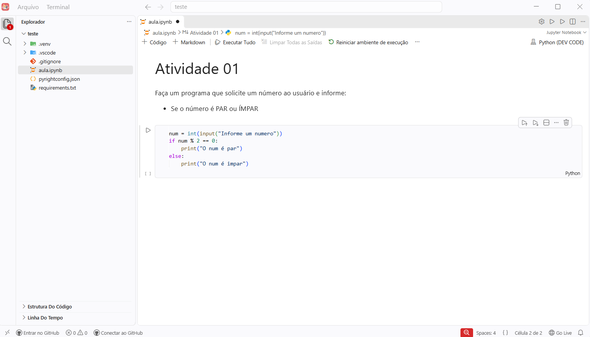
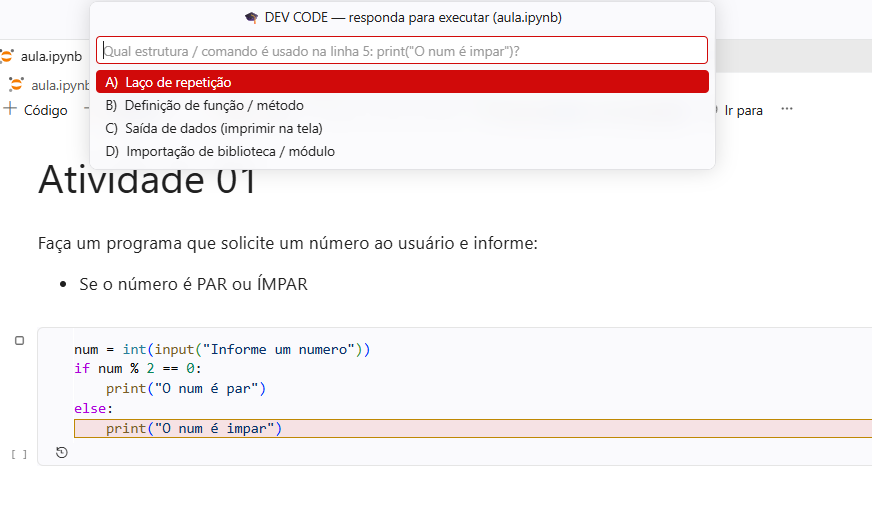

<p align="center">
  
</p>

<h1 align="center">DEV CODE: a IDE que faz o aluno <em>programar de verdade</em></h1>

<p align="center">
  <a href="https://github.com/igorcacerez/devcode/releases/latest/download/DEV-CODE-Setup.exe"></a>
</p>

<p align="center">
  <a href="https://github.com/igorcacerez/devcode/releases/latest">Todas as versões</a> ·
  <a href="#como-funciona">Como funciona</a> ·
  <a href="#instalação">Instalação</a> ·
  <a href="#para-desenvolvedores">Desenvolvimento</a>
</p>

---

## Por que o DEV CODE existe

Hoje muitos alunos não escrevem código: eles copiam do ChatGPT e colam na IDE. O **DEV CODE** é uma IDE para aulas de programação, baseada no [VS Code (Code - OSS)](https://github.com/microsoft/vscode), feita para que o aluno **escreva** e **entenda** o próprio código:

- 🚫 **Sem IA:** nada de Copilot, chat ou sugestões automáticas.
- 🚫 **Sem copiar e colar:** o código precisa ser digitado.
- 🚫 **Sem extensões de terceiros:** o aluno não instala nada.
- ❓ **Pergunta antes de executar:** ao rodar o código, a IDE faz uma pergunta sobre o que o aluno escreveu (lógica, sintaxe, estruturas). **Só roda se ele acertar.**
- 🗑️ **Arquivo de código colado na pasta é apagado:** se o aluno baixar um `index.html` do GPT e colar na pasta do projeto, o DEV CODE detecta e exclui. Imagens, áudios, vídeos e bancos `.fdb` são permitidos.

## Demonstração

<p align="center">
  <br>
  <em>Tela Inicial: o aluno cria um projeto ou baixa o seu do GitHub</em>
</p>

<p align="center">
  <br>
  <em>Projeto Colab: atividade de lógica com células de texto e de código, executadas pelo kernel Python do DEV CODE</em>
</p>

<p align="center">
  <br>
  <em>Antes de executar, o DEV CODE pergunta sobre o próprio código. Só roda se o aluno acertar.</em>
</p>

<p align="center">
  <br>
  <em>Novo projeto Colab: já vem com as instruções e o ambiente Python (.venv) pronto</em>
</p>

## Como funciona

### Tela Inicial
Ao abrir a IDE aparece a **Tela Inicial**, de onde o aluno:

| Ação | O que acontece |
|---|---|
| 🐍 **Python** | Cria a pasta com **ambiente virtual (`.venv`)**, estilo PyCharm. O aluno escolhe qual Python usar. |
| 📓 **Colab (notebook Python)** | Notebook igual ao **Google Colab**: células de código, resultado embaixo, `input()` dentro da célula, variáveis entre células. Ideal para **aulas de lógica**. |
| 🌐 **HTML, CSS e JavaScript** | Site com **Live Server** embutido: a página recarrega sozinha ao salvar. |
| ⚛️ **React** | Vite + React, mínimo, **sem TypeScript**. |
| 📱 **React Native (Expo)** | Template *blank*, **sem TypeScript**. O aluno testa no celular pelo **Expo Go**. |
| 🐙 **Projeto do Git** | Lista os repositórios da conta do aluno (ou aceita colar um link) e faz o `git clone`. |
| 📁 **Projetos recentes** | Reabre projetos criados pelo DEV CODE. |

> Só abrem projetos **criados ou baixados pelo DEV CODE**. Uma pasta montada por fora (com arquivos do GPT, por exemplo) é fechada na hora.

### A pergunta antes de executar
O aluno executa pelo botão **▶**, por **F5** ou rodando uma célula do notebook. Antes, o DEV CODE gera **offline e sem IA** uma pergunta de múltipla escolha sobre o próprio código. Exemplos:

- *Quantas vezes o laço da linha 8 executa?* / *Qual o último valor de `i`?*
- *Qual valor `y` recebe em `y = 17 % 5 + 2`?*
- *Quantos parâmetros a função `soma` recebe?*
- *Qual operador de comparação o `if` da linha 10 usa?* / *Qual o tipo do valor em `nome`?*
- HTML/CSS: *para que serve a tag `<ul>`?*, *o que o seletor `.titulo` seleciona?*, *o que significa `rem`?*
- React: *qual o valor inicial do estado `contagem`?*, *quando o `onPress` executa?*

Se o aluno **errar**, vê a resposta certa, espera alguns segundos e recebe **outra** pergunta. Se ele **alterar o código**, precisa responder de novo.

### Bloqueios
| | |
|---|---|
| Copiar, recortar, colar, arrastar texto | Bloqueados no editor, no terminal e no Explorer |
| IA (Copilot, chat, sugestões) | Removida do build e travada nas configurações |
| Extensões | Sem marketplace, sem VSIX, sem carregar extensões pela linha de comando |
| Terminal | Fecha se o aluno tentar `python -c`, abrir o REPL, gravar código com `echo > a.py`, abrir outro shell ou rodar o programa sem responder a pergunta. `pip install` e `npm install` são permitidos. |
| Git pelo terminal | Bloqueado. Tudo é feito pelos botões **Enviar** e **Atualizar** |
| Ferramentas de desenvolvedor, navegador embutido | Desativados |
| Tema | Somente **DEV CODE Light** (vermelho) |

### Git com cliques
- **Entrar no GitHub** pela própria IDE (código de dispositivo).
- **☁↑ Enviar:** o aluno escreve só a mensagem; a IDE faz commit e push.
- **☁↓ Atualizar:** faz o pull. Os arquivos que vêm do GitHub são aceitos automaticamente.
- **Conectar ao GitHub:** cria o repositório na conta do aluno com um clique.

### Interface
Em **português do Brasil**, com o menu reduzido a **Arquivo** e **Terminal**, a barra lateral só com **Explorador** e **Pesquisa**, ícones **Material Icon Theme** e autocomplete de Python (**basedpyright**), JavaScript, HTML e CSS.

## Instalação

1. Baixe o **[DEV-CODE-Setup.exe](https://github.com/igorcacerez/devcode/releases/latest/download/DEV-CODE-Setup.exe)**.
2. Execute o instalador. Ele também **instala as ferramentas das aulas**:
   - **Python 32 bits** (última versão com instalador oficial de 32 bits);
   - **Firebird** (última versão estável; usuário `SYSDBA`, senha `masterkey`);
   - **Node.js** (última versão; se já estiver instalado e houver versão mais nova, **atualiza**).

   O Windows pede permissão de administrador (UAC) **só se faltar alguma ferramenta**. O registro da instalação fica em `%TEMP%\devcode-tools.log`.

> ⚠️ O executável ainda não é assinado digitalmente, então o Windows SmartScreen pode avisar "Editor desconhecido". Clique em **Mais informações → Executar assim mesmo**.

### Atualização automática
O DEV CODE verifica as **[releases deste repositório](https://github.com/igorcacerez/devcode/releases)** ao abrir e a cada 6 horas. Quando há versão nova, aparece uma notificação. O aluno clica em **Atualizar agora**, a IDE baixa o instalador, fecha, atualiza (verificando também o Node) e abre de novo. Também dá para verificar em **Arquivo → Verificar Atualizações do DEV CODE**.

**Para publicar uma atualização:**
1. Aumente `devcodeVersion` no `product.json` (ex.: `1.0.1`).
2. Gere o instalador (veja abaixo).
3. Crie uma *release* com a tag `v1.0.1` e anexe o arquivo **`DEV-CODE-Setup.exe`** (o nome precisa ser exatamente esse).

## Para desenvolvedores

**Pré-requisitos (Windows):**
- Node.js na versão do [`.nvmrc`](.nvmrc);
- Python;
- Git;
- **Visual Studio Build Tools 2022** com "Desenvolvimento para desktop com C++".

**Rodar em modo de desenvolvimento.** Neste modo a interface fica em inglês, porque pacotes de idioma só valem na versão empacotada.
```bash
pnpm install
```
```bash
pnpm run compile
```
```bash
.\scripts\code.bat
```

**Gerar o aplicativo e o instalador:**
```bash
pnpm run gulp vscode-win32-x64-min
```
```bash
pnpm run gulp vscode-win32-x64-user-setup
```
O aplicativo fica em `..\VSCode-win32-x64\` e o instalador em `.build\win32-x64\user-setup\DEV-CODE-Setup.exe`.

### Onde está cada coisa
| Arquivo / pasta | Função |
|---|---|
| `extensions/devcode-quiz/` | Extensão principal do DEV CODE: pergunta antes de executar (`questions.js`), Tela Inicial, projetos, Live Server, notebooks/Colab (`notebookKernel.js` + `kernel/devcode_kernel.py`), Git, login no GitHub, vigia do terminal e de arquivos, atualizador |
| `src/vs/platform/devcode/common/lockedSettings.ts` | Configurações travadas (IA, extensões, tema, terminal…) |
| `src/vs/platform/devcode/common/menuFilter.ts` | Itens removidos dos menus |
| `src/vs/workbench/contrib/devcode/` | Bloqueio de copiar/colar, menus do DEV CODE e reinício para aplicar o português |
| `extensions/theme-defaults/themes/devcode-light.json` | Tema DEV CODE Light |
| `resources/win32/devcode-tools.ps1` | Instalação do Python 32 bits, Firebird e Node pelo instalador |
| `build/win32/code.iss` | Instalador (Inno Setup) |
| [`DEVCODE.md`](DEVCODE.md) | Documentação técnica detalhada de todas as alterações |

## Licença
O DEV CODE é baseado no **Code - OSS** da Microsoft, distribuído sob a [licença MIT](LICENSE.txt). DEV CODE não é afiliado à Microsoft. "Visual Studio Code" é marca da Microsoft.
