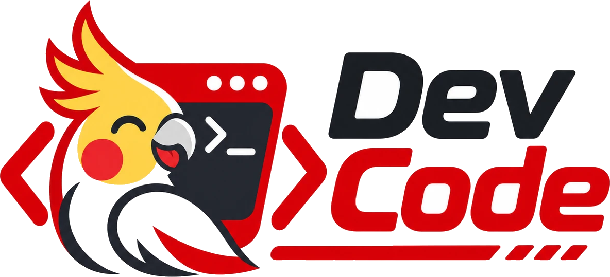
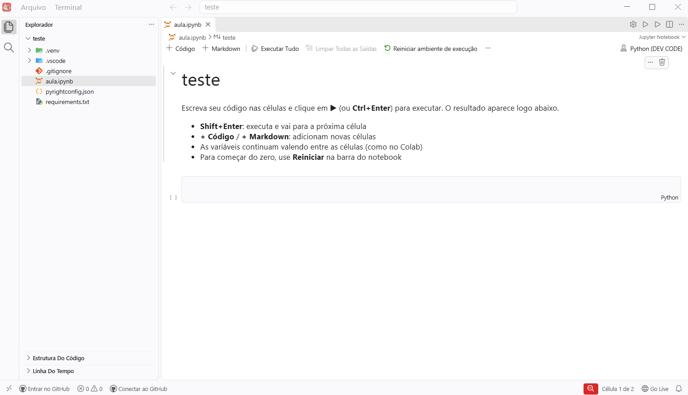

<p align="center">
  
</p>

<h1 align="center">DEV CODE: a IDE que faz o aluno <em>programar de verdade</em></h1>

<p align="center">
  <a href="https://github.com/igorcacerez/devcode/releases/latest/download/DEV-CODE-Setup.exe"></a>
</p>

<p align="center">
  <a href="https://github.com/igorcacerez/devcode/releases/latest">Todas as versões</a> ·
  <a href="#como-funciona">Como funciona</a> ·
  <a href="#instalação">Instalação</a> ·
  <a href="#para-desenvolvedores">Desenvolvimento</a>
</p>

---

## Por que o DEV CODE existe

Hoje muitos alunos não escrevem código: eles copiam do ChatGPT e colam na IDE. O **DEV CODE** é uma IDE para aulas de programação, baseada no [VS Code (Code - OSS)](https://github.com/microsoft/vscode), feita para que o aluno **escreva** e **entenda** o próprio código:

- 🚫 **Sem IA:** nada de Copilot, chat ou sugestões automáticas.
- 🚫 **Sem copiar e colar:** o código precisa ser digitado.
- 🚫 **Sem extensões de terceiros:** o aluno não instala nada.
- ❓ **Pergunta antes de executar:** ao rodar o código, a IDE faz uma pergunta sobre o que o aluno escreveu (lógica, sintaxe, estruturas). **Só roda se ele acertar.**
- 🗑️ **Arquivo de código colado na pasta é apagado:** se o aluno baixar um `index.html` do GPT e colar na pasta do projeto, o DEV CODE detecta e exclui. Imagens, áudios, vídeos e bancos `.fdb` são permitidos.

## Demonstração

<p align="center">
  <br>
  <em>Tela Inicial: o aluno cria um projeto ou baixa o seu do GitHub</em>
</p>

<p align="center">
  <br>
  <em>Projeto Colab: atividade de lógica com células de texto e de código, executadas pelo kernel Python do DEV CODE</em>
</p>

<p align="center">
  <br>
  <em>Antes de executar, o DEV CODE pergunta sobre o próprio código. Só roda se o aluno acertar.</em>
</p>

<p align="center">
  <br>
  <em>Novo projeto Colab: já vem com as instruções e o ambiente Python (.venv) pronto</em>
</p>

## Como funciona

### Tela Inicial
Ao abrir a IDE aparece a **Tela Inicial**, com os projetos organizados por categoria (**Programação**, **Web**, **Mobile**, **Design e Qualidade**), uma **busca** (ex.: "python", "site", "app"), os **projetos recentes** e atalhos para as **ferramentas** (Cliente de API, Banco de Dados, GitHub e Emulador Android). De lá o aluno:

| Ação | O que acontece |
|---|---|
| 🐍 **Python** | Cria a pasta com **ambiente virtual (`.venv`)**, estilo PyCharm. O aluno escolhe qual Python usar. |
| 📓 **Colab (notebook Python)** | Notebook igual ao **Google Colab**: células de código, resultado embaixo, `input()` dentro da célula, variáveis entre células. Ideal para **aulas de lógica**. |
| 🎨 **Protótipo (telas)** | Editor visual estilo **Figma**, simplificado e **sem IA**: frames **Mobile** e **Desktop**, retângulos, elipses, linhas, textos e imagens, **camadas** e **estilos** (cores, bordas, cantos, sombra, tipografia). Exporta cada tela em PNG. |
| 🌐 **HTML, CSS e JavaScript** | Site com **Live Server** embutido: a página recarrega sozinha ao salvar. No menu do ▶ há também **Executar no navegador do computador** (Chrome, Edge…). |
| ⚛️ **React** | Vite + React, mínimo, **sem TypeScript**. |
| 📱 **React Native (Expo)** | Template *blank*, **sem TypeScript**. Roda no **emulador Android integrado** (instalação única) ou no celular pelo **Expo Go**. |
| 🧪 **Teste de Software** | Testes automatizados de sites **estilo Selenium**, 100% visuais: gravar ações, verificações, suítes e **relatório** de sucessos e erros. |
| 📂 **Projeto em branco** | Só cria a pasta: o aluno monta tudo do zero, em qualquer linguagem. |
| 🐙 **Projeto do Git** | Lista os repositórios da conta do aluno (ou aceita colar um link) e faz o `git clone`. |
| 📁 **Projetos recentes** | Reabre projetos criados pelo DEV CODE. |

> Só abrem projetos **criados ou baixados pelo DEV CODE**. Uma pasta montada por fora (com arquivos do GPT, por exemplo) é fechada na hora.

### A pergunta antes de executar
O aluno executa pelo botão **▶**, por **F5** ou rodando uma célula do notebook. Antes, o DEV CODE gera **offline e sem IA** uma pergunta de múltipla escolha sobre o próprio código. Exemplos:

- *Quantas vezes o laço da linha 8 executa?* / *Qual o último valor de `i`?*
- *Qual valor `y` recebe em `y = 17 % 5 + 2`?*
- *Quantos parâmetros a função `soma` recebe?*
- *Qual operador de comparação o `if` da linha 10 usa?* / *Qual o tipo do valor em `nome`?*
- HTML/CSS: *para que serve a tag `<ul>`?*, *o que o seletor `.titulo` seleciona?*, *o que significa `rem`?*
- React: *qual o valor inicial do estado `contagem`?*, *quando o `onPress` executa?*

Se o aluno **errar**, vê a resposta certa, espera alguns segundos e recebe **outra** pergunta. Se ele **alterar o código**, precisa responder de novo.

### Bloqueios
| | |
|---|---|
| Copiar, recortar, colar, arrastar texto | Bloqueados no editor, no terminal e no Explorer |
| IA (Copilot, chat, sugestões) | Removida do build e travada nas configurações |
| Extensões | Sem marketplace, sem VSIX, sem carregar extensões pela linha de comando |
| Terminal | Fecha se o aluno tentar `python -c`, abrir o REPL, gravar código com `echo > a.py`, abrir outro shell ou rodar o programa sem responder a pergunta. `pip install` e `npm install` são permitidos. |
| Git pelo terminal | Bloqueado. Tudo é feito pelos botões **Enviar** e **Atualizar** |
| Ferramentas de desenvolvedor, navegador embutido | Desativados |
| Tema | Somente **DEV CODE Light** (vermelho) |

> **Exceção:** **colar** (Ctrl+V) é liberado somente dentro do **Cliente de API** e do **Teste de Sites**, para URLs e tokens. Copiar continua bloqueado, e colar continua bloqueado no editor de código, no terminal e no resto da IDE.

### Modo Protótipo
O Figma tem muita IA e os alunos acabam copiando telas prontas. No **Protótipo** do DEV CODE o aluno desenha a tela do zero:

- **Frames:** Mobile (390 × 844) e Desktop (1440 × 900). Um frame novo nunca nasce por cima de outro.
- **Ferramentas:** Mover `V`, Frame Mobile `F`, Frame Desktop `D`, Retângulo `R`, Elipse `O`, Linha `L`, Texto `T` e **Imagem de qualquer pasta do computador**. A imagem é copiada automaticamente para a pasta `imagens/` do projeto; se já existir outra com o mesmo nome, vira `foto-1.png`, `foto-2.png`…
- **Arrastar imagens do Windows** (Explorador de Arquivos) direto para a tela: a imagem é copiada para `imagens/` e aparece no ponto onde foi solta, dentro do frame que estiver embaixo.
- **Camadas:** hierarquia por frame, ocultar/mostrar, travar, renomear (duplo clique) e **reordenar arrastando** (com linha indicando onde vai cair). Arrastar uma camada para cima de um frame ou grupo a coloca **dentro** dele.
- **Grupos:** selecione várias camadas e use **`Ctrl+G`** (ou o botão **▣ Agrupar**). **`Ctrl+Shift+G`** desagrupa. Clicar num elemento do grupo seleciona o grupo inteiro; com **duplo clique** você entra no grupo e edita só aquele elemento. O grupo pode ter opacidade, filtros, rotação e CSS próprios.
- **Estilos completos de CSS** para caixas, textos, frames e imagens:
  - **Aparência:** opacidade (inclusive de frames e imagens), modo de mesclagem, rotação, inclinação e espelhamento.
  - **Preenchimento:** cor com transparência, **degradê linear ou radial** com várias cores, ou nenhum.
  - **Borda:** cor, estilo (sólida, tracejada, pontilhada, dupla…) e espessura geral ou **por lado**; **cantos arredondados** iguais ou por canto; **espaçamento interno (padding)**.
  - **Sombras:** várias, externas ou internas (`inset`), com deslocamento, desfoque, expansão e cor; **contorno (outline)**.
  - **Tipografia:** **todas as 1.749 fontes do Google Fonts**, com busca, prévia e categoria. Também tamanho, peso (100 a 900), cor, alinhamento horizontal e vertical, altura da linha, espaçamento entre letras e entre palavras, recuo, itálico, sublinhado/tachado/sobrelinha (estilo, cor e espessura), maiúsculas/minúsculas, sombra no texto, sem quebra de linha e reticências.
  - **Filtros:** desfoque, brilho, contraste, saturação, preto e branco, sépia, inverter, matiz e **desfoque do fundo** (vidro fosco).
  - **CSS personalizado:** campo para qualquer outra propriedade CSS (ex.: `clip-path`, `border-image`).
- A **exportação PNG** é feita a partir do próprio HTML/CSS, com as fontes do Google embutidas, e fica idêntica à tela.
- **Desfazer/refazer** (`Ctrl+Z`/`Ctrl+Y`), duplicar (`Ctrl+D`), alinhar várias camadas, zoom (`Ctrl`+roda) e mover a tela (`Espaço`+arrastar).
- **Exportar PNG** de cada frame para a pasta `exportacoes/`.
- Arquivos `.devproto` também são protegidos: um protótipo colado de fora é excluído.

### Emulador Android (React Native)
Na primeira execução de um projeto Expo, o DEV CODE pergunta onde abrir o app. Com **Emulador Android**, ele:
- instala **uma única vez** o necessário (~1,5 GB), reaproveitando um SDK que já exista (Android Studio): Java 17, ferramentas do Android, emulador e uma imagem **Android 14 AOSP**, a mais leve, sem Google Play;
- cria o aparelho **DevCode** com 2 GB de RAM;
- a cada ▶/F5, liga o emulador se precisar e roda `npx expo start --android --localhost`. O Expo instala o Expo Go e **abre o app do aluno no emulador**, sem precisar do celular.
- A conexão usa `localhost` (via `adb reverse`), então funciona mesmo com o firewall da rede do laboratório bloqueando o IP local.
- Se o emulador fechar sozinho (tela preta), o DEV CODE tenta de novo em modos mais compatíveis: renderização por software, tela 720×1280 com menos memória e sem Vulkan, e depois via Direct3D. O modo que funcionar fica salvo para as próximas vezes. O registro, com o código de saída de cada tentativa, fica em `%TEMP%\devcode-emulator.log`.

> Requer virtualização ativada no computador (BIOS + "Plataforma do Hipervisor do Windows"). Também pode ser aberto em **Terminal → Ligar Emulador Android**.

### Banco de Dados (estilo DBeaver)
O ícone **🛢 Banco de Dados** na barra lateral abre a área de manipulação de bancos:

- **Conexões:**
  - **Firebird:** escolha o arquivo `.fdb` ou crie um banco novo;
  - **SQLite:** abra um arquivo `.db`/`.sqlite` ou crie um novo. Não precisa instalar nada, porque o SQLite já vem dentro do DEV CODE;
  - **MySQL** e **PostgreSQL:** servidor, porta, usuário, senha e banco. No MySQL dá para escolher ou criar o banco na hora.
  - As senhas ficam no cofre seguro do Windows.
- **Árvore do banco (dicionário):** tabelas, views, triggers, procedures/funções e generators/sequences. Em cada tabela aparecem as colunas com tipo, `NOT NULL`, 🔑 **PK** e 🔗 **FK → tabela.coluna**, além das chaves estrangeiras (com `ON UPDATE/DELETE`), dos índices e das triggers.
- **Ver registros** (até 500) e **Dicionário da tabela:** colunas, PK, FKs, índices, triggers e o **DDL** (script de criação).
- **Editor SQL:**
  - **`Ctrl+Enter`** executa a instrução onde está o cursor (ou só o trecho selecionado);
  - **`Alt+X`** / **`F5`** executa o script inteiro, entendendo `SET TERM ^ ;` do Firebird, `$$` do PostgreSQL, comentários e strings.
- **Resultados:** uma aba por instrução, grade com ordenação por coluna e filtro, tempo de execução, linhas afetadas e mensagens de erro claras.
- Ver o código de **triggers, procedures e views** com um clique.

### Projeto de Teste de Software (estilo Selenium)
Feito para a matéria de **Teste de Software**. O aluno cria testes automatizados de sites **sem programar**, de forma visual, como no Selenium IDE:

1. **Tela Inicial → Novo projeto de Teste**: cria a pasta com `testes.devtest` e `relatorios/`.
2. Informe a **URL base** do site.
3. Organize em **suítes** (tipos de teste, ex.: *Login*, *Cadastro*, *Carrinho*), cada uma com seus **casos de teste**.
4. Clique em **⏺ Gravar**: o Microsoft Edge do computador abre o site e cada **clique, digitação (inclusive em campos de senha), seleção e Enter** vira uma etapa da tabela. Uma barrinha dentro da página permite adicionar verificações clicando no elemento: **Verificar texto**, **Verificar visível** e **Verificar título**.
5. Ajuste as etapas na tabela (comando, alvo e valor), arraste para mudar a ordem, adicione ou remova.
6. **▶ Executar caso**, **Executar suíte** ou **Executar tudo**: cada etapa fica verde (passou) ou vermelha (falhou) ao vivo.

**Comandos:** abrir, clicar, digitar, selecionar, marcar/desmarcar, pressionar tecla, aguardar elemento, pausa e as verificações de texto, texto que contém, valor, visível, não visível, título, URL e quantidade de elementos.
**Localizadores:** `id=`, `name=`, `css=`, `xpath=` e `text=`. Na gravação, o DEV CODE escolhe o mais estável (id, `data-testid`, name, texto do botão/link e, por último, CSS curto).
**Execução robusta:** cada etapa espera o elemento aparecer (até 10 s) antes de agir. Uma falha não interrompe os outros casos, e uma **captura de tela** é tirada no momento do erro.

**Relatório:** ao final é gerado um HTML em `relatorios/relatorio-AAAA-MM-DD_HH-mm-ss.html` com:
- o resumo (total, quantos passaram, quantos falharam, duração e um gráfico);
- o resultado de cada suíte, caso e etapa;
- a mensagem de erro em português e a captura de tela de cada falha.

> Usa o Microsoft Edge (ou Google Chrome) já instalado no Windows; nada é baixado.

**Ordem:** etapas, casos de teste e suítes são reordenados arrastando (⠿). Um caso também pode ser arrastado para outra suíte. A execução segue essa ordem.

### Diagramas (estilo Microsoft Visio)
Novo tipo de projeto **Diagramas** para as aulas de modelagem. O aluno arrasta formas da esquerda para a página e liga uma na outra puxando os pontos azuis:
- **Fluxograma:** início/fim, processo, decisão, entrada/saída, documento, sub-processo, preparação, banco de dados e conector.
- **Diagrama de classes (UML):** classe, interface, classe abstrata, enum, pacote e nota. Atributos e métodos um por linha; a classe cresce sozinha. Ligações de associação, herança, implementação, dependência, agregação e composição.
- **Banco de dados (DER):** tabela com colunas `nome TIPO PK/FK` (chaves destacadas), entidade, entidade fraca, relacionamento e atributos. Ligações 1:1, 1:N, N:N e 0:N com pé de galinha.
- **Casos de uso:** ator, caso de uso e sistema (o que está dentro do sistema se move junto).
- Ligações em ângulo reto que acompanham as formas, com texto no meio e nas pontas (ex.: "Sim"/"Não", "1"/"*"). Soltar a ligação no vazio cria uma forma nova já ligada.
- Dois cliques para escrever, cores, alinhamento, guias, zoom, várias **páginas** no mesmo arquivo e exportação para **PNG** ou **SVG** (pasta `exportacoes`).

### Cliente de API (estilo Postman)
O ícone **Cliente de API** na barra lateral testa APIs sem instalar o Postman ou o Insomnia:
- **Requisições** GET, POST, PUT, PATCH, DELETE, HEAD e OPTIONS, com **parâmetros** (sincronizados com a URL), **cabeçalhos**, **corpo** (JSON com validação e botão Formatar, texto, formulário `x-www-form-urlencoded` e `multipart` com envio de arquivos) e **autenticação** (Bearer/JWT e Basic).
- **Resposta** com status colorido (e o significado em português), tempo, tamanho, JSON formatado e colorido, cabeçalhos, imagens; dá para copiar ou salvar em arquivo.
- **Coleções** para organizar as requisições de cada API, com duplicar, renomear e apagar; **histórico** das últimas 50 requisições enviadas.
- **Ambientes** com variáveis: `{{base_url}}/usuarios` e `Bearer {{token}}`. Troca de Local para Produção num clique.
- **Importar cURL** copiado da documentação de uma API.
- Mensagens de erro explicadas (ex.: "o servidor não está rodando nessa porta").
- As requisições saem da própria IDE, então não há bloqueio de CORS. Tudo fica salvo na conta do usuário e vale para todos os projetos. Atalho para enviar: **Ctrl+Enter**.

### Painel GitHub (estilo GitHub Desktop)
O ícone do GitHub na barra lateral abre um painel com tudo o que o aluno precisa, sem digitar comandos:
- **Conta:** entrar e sair (importante nos computadores do laboratório).
- **Projeto aberto:** branch, link do repositório, **⬇ Atualizar (pull)** e **⬆ Enviar (push)** com o número de commits ainda não enviados.
- **Alterações:** lista dos arquivos modificados, novos e apagados, com caixas para escolher o que entra no commit; clicar no arquivo mostra as diferenças. Escreve a mensagem e clica em **Commit** ou **Commit e enviar**.
- **Histórico:** os últimos 20 commits, com autor e data.
- **Meus repositórios:** lista e filtro dos repositórios da conta, **Baixar** (clone, já liberado no vigia de arquivos) e **Publicar no GitHub** para criar um repositório novo com o projeto aberto.

### Código vindo do GitHub: assinatura e quarentena
Para impedir que o aluno escreva o código fora (com IA, pelo site do GitHub ou em outro editor) e traga para a IDE com um **pull** ou **clone**:
- **Assinatura:** todo commit feito no DEV CODE (painel GitHub, botão Enviar ou aba Source Control) recebe uma assinatura `DevCode-Assinatura` calculada sobre as alterações. Copiar a assinatura para outro commit não funciona.
- **Quarentena:** no pull ou clone, arquivos que vieram de commits sem assinatura não entram no projeto. Ficam em **Quarentena** (ícone 🛡 na barra de status): o aluno pode ver o conteúdo, somente leitura, mas precisa digitar de novo.
- **Liberação pelo professor:** o comando **Liberar arquivos da quarentena (professor)** pede a **senha de administrador do Windows** (tela do UAC). Também dá para **confiar em um repositório**, como os exemplos do professor, e aí os pulls dele entram direto.
- **Relatório de autoria:** o comando **Relatório de autoria do código** mostra, por arquivo, quanto foi digitado na IDE, quanto veio do GitHub assinado, quanto foi para a quarentena e quanto o professor liberou.

### Git com cliques
- **Entrar no GitHub** pela própria IDE (código de dispositivo).
- **☁↑ Enviar:** o aluno escreve só a mensagem; a IDE faz commit e push.
- **☁↓ Atualizar:** faz o pull. Os arquivos que vêm do GitHub são aceitos automaticamente.
- **Conectar ao GitHub:** cria o repositório na conta do aluno com um clique.

### Interface
Em **português do Brasil**, com o menu reduzido a **Arquivo** e **Terminal**, a barra lateral só com **Explorador**, **Pesquisa** e **Banco de Dados**, ícones **Material Icon Theme** e autocomplete de Python (**basedpyright**), JavaScript, HTML e CSS.

### .gitignore automático
Todo projeto criado pelo DEV CODE (e todo projeto conectado ao GitHub) já vem com um `.gitignore` pronto: ignora `.devcode/`, `.venv/`, `__pycache__/`, `node_modules/`, `dist/`, `.env` e arquivos do sistema. Se o projeto já tiver um `.gitignore`, o DEV CODE só acrescenta as linhas que faltam.


## Instalação

1. Baixe o **[DEV-CODE-Setup.exe](https://github.com/igorcacerez/devcode/releases/latest/download/DEV-CODE-Setup.exe)**.
2. Execute o instalador. Na tela **"Ferramentas das aulas"**, escolha o que deve ser instalado junto com a IDE. Assim o computador do aluno, mesmo "cru", fica pronto:

   | Ferramenta | Padrão | Detalhes |
   |---|:---:|---|
   | **Python 3 (32 bits)** | ✅ | última versão com instalador oficial de 32 bits |
   | **Python 3 (64 bits)** | | última versão |
   | **Firebird** | ✅ | última estável; usuário `SYSDBA`, senha `masterkey` |
   | **MySQL** | | 8.4 LTS, serviço `MySQL`, porta 3306; usuário `root`, **sem senha** |
   | **PostgreSQL** | | última versão, porta 5432; usuário `postgres`, senha `postgres` |
   | **Node.js** | ✅ | última versão; se já houver uma mais antiga, **atualiza** |
   | **Emulador Android** | ✅ | SDK + emulador + Android 14 em `C:\DevCode\android`, para todos os usuários; ativa a *Plataforma do Hipervisor do Windows* (reiniciar uma vez). Cerca de 2 GB |
   | **PHP** | | última versão (NTS x64) em `C:\DevCode\php`, no PATH, com as extensões de banco ativadas |
   | **Git** | ✅ | última versão do Git for Windows (necessário para o painel GitHub) |

   O que já estiver instalado é mantido. O Windows pede permissão de administrador (UAC) **só se houver algo para instalar**. O registro fica em `%TEMP%\devcode-tools.log`.

> ⚠️ O executável ainda não é assinado digitalmente, então o Windows SmartScreen pode avisar "Editor desconhecido". Clique em **Mais informações → Executar assim mesmo**.

### Atualização automática
O DEV CODE verifica as **[releases deste repositório](https://github.com/igorcacerez/devcode/releases)** ao abrir e a cada 6 horas. Quando há versão nova, aparece uma notificação. O aluno clica em **Atualizar agora**, a IDE baixa o instalador, fecha, atualiza (verificando também o Node) e abre de novo. Também dá para verificar em **Arquivo → Verificar Atualizações do DEV CODE**.

**Para publicar uma atualização:**
1. Aumente `devcodeVersion` no `product.json` (ex.: `1.0.1`).
2. Gere o instalador (veja abaixo).
3. Crie uma *release* com a tag `v1.0.1` e anexe o arquivo **`DEV-CODE-Setup.exe`** (o nome precisa ser exatamente esse).

## Para desenvolvedores

**Pré-requisitos (Windows):**
- Node.js na versão do [`.nvmrc`](.nvmrc);
- Python;
- Git;
- **Visual Studio Build Tools 2022** com "Desenvolvimento para desktop com C++".

**Rodar em modo de desenvolvimento.** Neste modo a interface fica em inglês, porque pacotes de idioma só valem na versão empacotada.
```bash
pnpm install
```
```bash
pnpm run compile
```
```bash
.\scripts\code.bat
```

**Gerar o aplicativo e o instalador:**
```bash
pnpm run gulp vscode-win32-x64-min
```
```bash
pnpm run gulp vscode-win32-x64-user-setup
```
O aplicativo fica em `..\VSCode-win32-x64\` e o instalador em `.build\win32-x64\user-setup\DEV-CODE-Setup.exe`.

### Onde está cada coisa
| Arquivo / pasta | Função |
|---|---|
| `extensions/devcode-quiz/` | Extensão principal do DEV CODE: pergunta antes de executar (`questions.js`), Tela Inicial, projetos, Live Server, notebooks/Colab (`notebookKernel.js` + `kernel/devcode_kernel.py`), Git, login no GitHub, vigia do terminal e de arquivos, atualizador |
| `src/vs/platform/devcode/common/lockedSettings.ts` | Configurações travadas (IA, extensões, tema, terminal…) |
| `src/vs/platform/devcode/common/menuFilter.ts` | Itens removidos dos menus |
| `src/vs/workbench/contrib/devcode/` | Bloqueio de copiar/colar, menus do DEV CODE e reinício para aplicar o português |
| `extensions/theme-defaults/themes/devcode-light.json` | Tema DEV CODE Light |
| `resources/win32/devcode-tools.ps1` | Instalação do Python 32 bits, Firebird e Node pelo instalador |
| `build/win32/code.iss` | Instalador (Inno Setup) |
| [`DEVCODE.md`](DEVCODE.md) | Documentação técnica detalhada de todas as alterações |

## Licença
O DEV CODE é baseado no **Code - OSS** da Microsoft, distribuído sob a [licença MIT](LICENSE.txt). DEV CODE não é afiliado à Microsoft. "Visual Studio Code" é marca da Microsoft.
